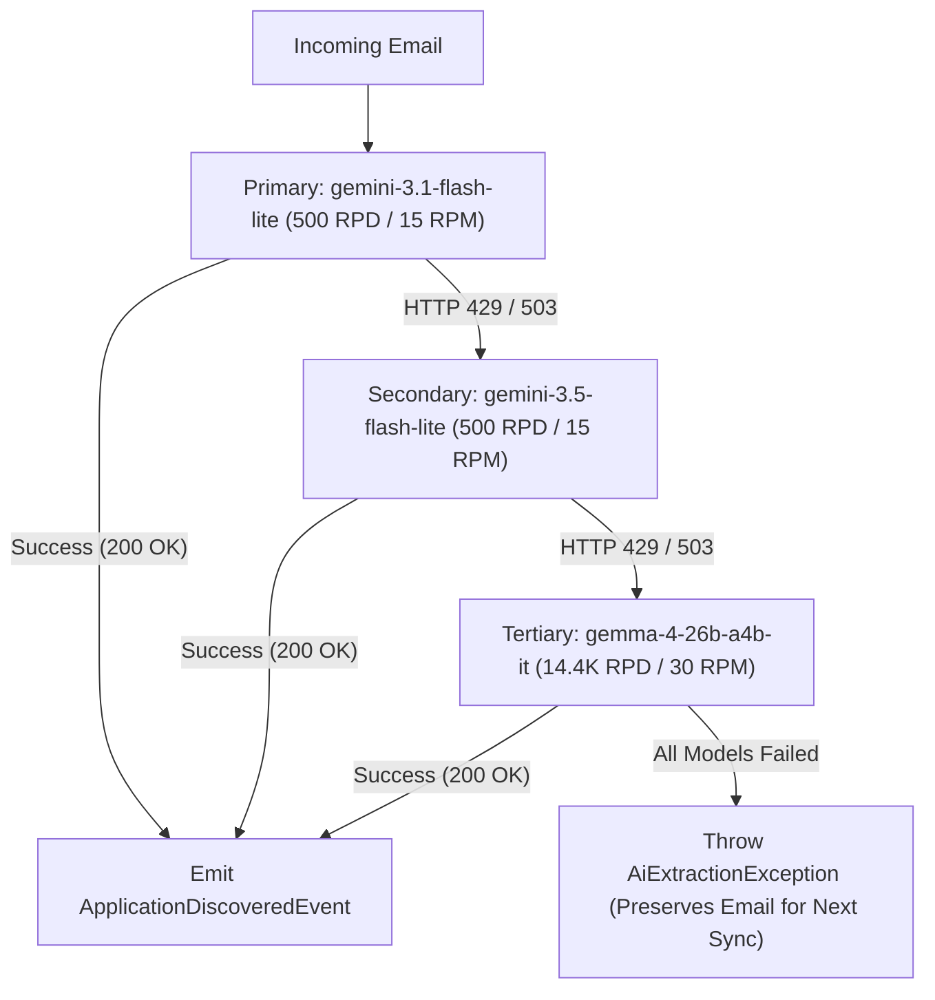

# AI Ingestion Fallback Architecture & Application Deduplication Specification

## 1. Problem Statement & Rate Limit Constraints

JobTrackr uses Google Gemini API to extract structured job application data from unstructured emails. Free-tier Google AI Studio accounts enforce strict per-model rate limits:

- **Preview/Flash Models** (`gemini-3.6-flash`, `gemini-2.5-flash`, `gemini-3.8-flash`): Limited to **20 Requests Per Day (RPD)** and **5 Requests Per Minute (RPM)**.
- **Flash-Lite Models** (`gemini-3.1-flash-lite`, `gemini-3.5-flash-lite`): Allotted **500 Requests Per Day (RPD)** and **15 Requests Per Minute (RPM)** each.
- **Open-Weights Models** (`gemma-4-26b-a4b-it`, `gemma-4-31b-it`): Allotted **14,400 Requests Per Day (RPD)** and **30 Requests Per Minute (RPM)**.

Relying on a single preview model causes rapid HTTP 429 (`RESOURCE_EXHAUSTED`) failures during bulk inbox synchronization.

---

## 2. API Key Management

- In Google AI Studio, an API key is scoped to the **Google Cloud Project**, not an individual model.
- A single `GEMINI_API_KEY` authenticates all models available within that project.
- No per-model credentials or multiple environment variables are required. Only the `"model"` field in the request payload varies.

---

## 3. Resilient Multi-Model Fallback Architecture

### Fallback Execution Chain



### Circuit Breaker & Cooldown Mechanics
1. **Configurable Model Chain**: Configured via `jobtrackr.ai.models=gemini-3.1-flash-lite,gemini-3.5-flash-lite,gemma-4-26b-a4b-it`.
2. **Dynamic Cooldown Tracking**: When a model returns HTTP 429 with a `retryDelay` (or default 5-minute cooldown), the client marks that model in an in-memory `cooldownUntil` map.
3. **Zero-Overhead Routing**: Subsequent emails in the current sync batch skip cooled-down models immediately without incurring failed HTTP requests.
4. **Transient Retry vs Error Retention**: If all configured models in the fallback chain fail, the service throws `AiExtractionException`. The worker catches this exception and bypasses recording the email in `processed_emails`, ensuring it is retried during the next polling cycle.

---

## 4. Application Deduplication & Multi-Email Merge Specification

When an incoming email matches an existing application by `userId`, normalized `companyName`, and `role`:

### A. Source Precedence Hierarchy
Specific job boards supersede generic email ingestion tags:
$$\text{Verified Job Boards (INDEED, LINKEDIN, NAUKRI, etc.)} > \text{COMPANY\_WEBSITE / REFERRAL} > \text{EMAIL} > \text{OTHER}$$
- If an existing record has `source = EMAIL` and a newly merged email originates from `INDEED`, the record's source is upgraded to `INDEED`.

### B. Field Enrichment (Non-Destructive)
For candidate applications awaiting review (`requiresReview = true`):
- **Empty Field Population**: If `salaryMin`, `salaryMax`, `currency`, `location`, `jobUrl`, or `workMode` is null on the existing application and provided by the incoming email, populate it.
- **Earliest Application Date**: `appliedDate` is set to $\min(\text{existing.appliedDate}, \text{incoming.appliedDate})$.
- **Status Lifecycle Progression**: If existing status is `APPLIED` and the incoming email is a terminal or advancement status (`INTERVIEW`, `TECHNICAL_ROUND`, `HR_ROUND`, `OFFER`, `REJECTED`), update `status`.

### C. Multi-Email Context Chronology (Ascending Order)
To provide a complete audit trail in the review drawer, email contexts are arranged in chronological order:

```text
=== [2026-10-05 17:50:49 UTC] Application Received - Thank You! (notifications@recooty.com) ===
[Email snippet 1 text]

=== [2026-10-05 17:50:50 UTC] Indeed Application: Java Developer (indeedapply@indeed.com) ===
[Email snippet 2 text]
```

- If an older email is processed after a newer email, it is prepended.
- If a newer email arrives after an older email, it is appended.
- The UI review drawer renders the entire chronological journey from initial application to latest update.
